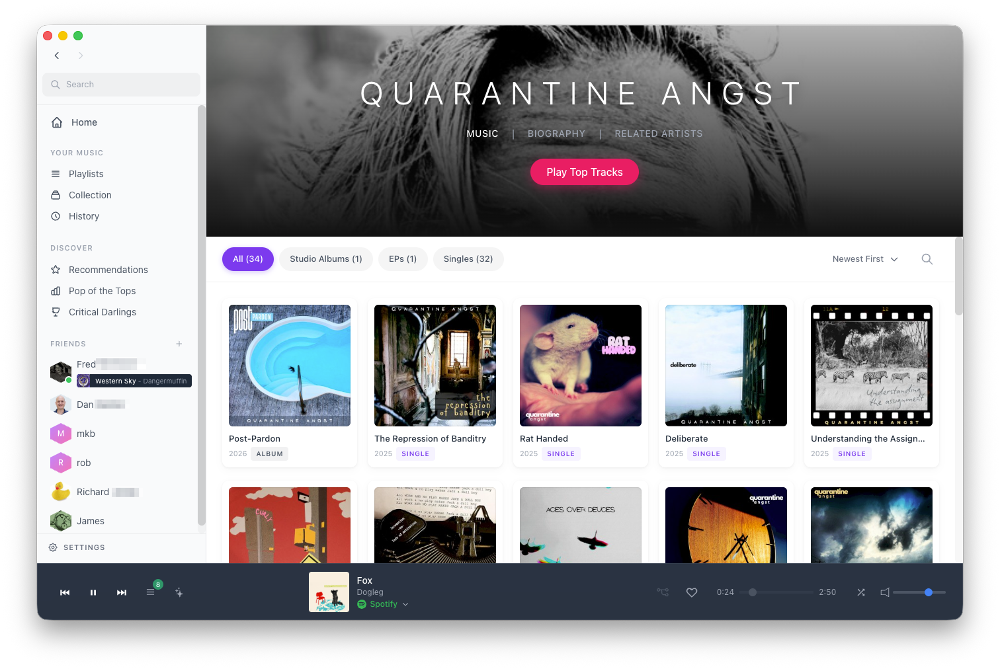

# Parachord

https://parachord.com

A modern multi-source music player inspired by [Tomahawk](https://github.com/tomahawk-player/tomahawk). Play music from Spotify, Apple Music, Amazon Music, YouTube, Bandcamp, SoundCloud, your own Subsonic server, local files, and more - all in one unified interface.



## Features

### Multi-Source Playback
- **Unified Library** - Search and play from multiple services simultaneously
- **Smart Resolution** - Automatically finds the best available source for each track, with incremental results as resolvers respond
- **Source Priority** - Drag to reorder which services are preferred
- **Volume Normalization** - Balance loudness between different sources
- **Buy Links** - Bandcamp purchase buttons surfaced for any track that can be found, even when streaming from a different source

### Supported Sources
- **Spotify** - Full Spotify Connect integration with remote playback (Premium required)
- **Apple Music** - Full playback via native MusicKit on macOS or MusicKit JS on Windows and Linux (subscription required). Windows and Linux playback needs the Widevine CDM, which Parachord downloads on first launch (see [System Requirements](#system-requirements))
- **Amazon Music** - Plays in Parachord's own player, using the same streams and licenses Amazon's web player uses, decrypted by the Widevine CDM on every platform (Amazon Music account required; you sign in once in a Parachord window). It does not use the Amazon Music desktop app
- **YouTube** - Stream audio from YouTube videos
- **Bandcamp** - Browse, play, and purchase from independent artists
- **SoundCloud** - Stream from SoundCloud's catalog
- **Subsonic** - Stream from your own Subsonic-compatible server (Navidrome, Airsonic, Gonic, ...)
- **Local Files** - Scan and play your local music library with metadata extraction

### Plug-in Architecture
- **Trusted Code** - Plug-ins are not sandboxed: they run in the app's renderer with the same access as Parachord's own code, so install only plug-ins you trust
- **Marketplace** - Browse and install plug-ins from the built-in marketplace
- **.axe Format** - Simple JSON-based plug-in format for content resolvers, meta services, and AI backends
- **Hot Reload** - Develop and test plug-ins without restarting

### AI Companion
- **Shuffleupagus** - Built-in AI DJ that can recommend music, generate playlists, and control playback
- **Multiple AI Backends** - Choose from ChatGPT, Claude, Google Gemini, Ollama (local/offline), or any OpenAI- or Anthropic-compatible endpoint via the Custom LLM plug-in (LM Studio, vLLM, llama.cpp, OpenRouter, ...)
- **MCP Server** - Exposes playback and queue controls to external AI agents like Claude Desktop via the Model Context Protocol

### Library Sync
- **Import from Streaming Services** - Sync your playlists and liked songs from Spotify, Apple Music, and more
- **Collection Management** - Build a unified collection from multiple sources
- **Favorites** - Star tracks to add them to your collection
- **Sync Safety** - Mass-removal safeguard detects and blocks bulk deletions to prevent accidental data loss

### Artist Discovery
- **Rich Artist Pages** - Browse full discographies powered by MusicBrainz, with biographies from Wikipedia and Discogs
- **Related Artists** - Discover similar artists via Last.fm
- **Album Art** - High-quality artwork from Cover Art Archive
- **Release Filtering** - Filter by albums, EPs, singles, live releases, and compilations
- **Charts** - Browse top albums and songs from iTunes and Last.fm, filterable by country

### Playlists & Queue
- **URL Import** - Paste Spotify, Apple Music, Amazon Music, SoundCloud, YouTube, or hosted .xspf playlist URLs
- **File Import** - Load local .xspf playlist files
- **Export** - Save any playlist, or the current queue, as an .xspf file
- **Queue Management** - Add tracks, reorder, and manage your listening queue
- **Shuffle & Spinoff** - Shuffle your queue, or "spinoff" from any track into a radio station of similar music
- **Mixed-Source Queues** - Seamlessly play tracks from different services
- **Resolver Blocklist** - Report and block bad source matches without disabling an entire resolver

### Sharing
- **Discord Rich Presence** - Opt-in "Listening to Parachord" presence on your Discord profile, with cover art when it's a public https image (Settings → General)
- **Copy link** - "Copy link" on a track, album, artist or playlist copies an [Achordion](https://achordion.xyz) page that links the music on every service

### Browser Extension
- **Send to Parachord** - Right-click any song link to send it to the desktop app
- **Page Detection** - Green badge indicator when the current page is a supported playlist or album
- **Import Playlists & Albums** - Scrape Spotify, Apple Music, Bandcamp, SoundCloud, and YouTube pages directly into your queue
- **Native Messaging** - The extension talks to the desktop app through a native messaging host, so it needs no open network port

### Social Features
- **Friend Activity** - See what your friends are listening to in real-time via Last.fm and ListenBrainz
- **Listen Along** - Join a friend's listening session in near-real-time
- **Listening History** - Browse your play history and track your activity

### Additional Features
- **Global Search** - Search across all sources with unified results
- **Collection View** - Browse your aggregated music collection
- **Recommendations** - Personalized suggestions via Last.fm, ListenBrainz Weekly Jams, and AI (full inventory in [docs/features/RECOMMENDATIONS.md](docs/features/RECOMMENDATIONS.md); import and sync paths in [docs/features/PLAYLIST_IMPORT_AND_SYNC.md](docs/features/PLAYLIST_IMPORT_AND_SYNC.md))
- **Scrobbling** - Track your listening history with Last.fm, ListenBrainz, and Libre.fm
- **Deep Links** - `parachord://` protocol for opening artists, albums, playlists, and search from other apps
- **Application Menu** - Full menu bar with keyboard shortcuts
- **Auto-Updates** - Automatic update checking with GitHub Releases
- **Configurable Media Keys** - Choose whether Parachord captures media keys always, only when you're not using Spotify, or never (Spotify may capture them too)

## Subscriptions and copy protection

Parachord is a player for people who already subscribe to the services it plays from, plus their own files and servers. It brings those services together in one app. It is not a way to get music without paying for it, or to keep copies of it.

- **Your account, the service's own streams.** Each service plays through your own account, using that service's own player, its official API, or the same endpoints its own web player uses. Either way, the stream, its license and its quality come from the service. On the subscription services (Spotify, Apple Music, Amazon Music), your plays are reported to the service the way its own player reports them, so they count. Where a service needs a subscription for full tracks, so does Parachord.
- **No ripping.** Parachord doesn't decrypt, record, download or save protected streams. It doesn't extract decryption keys, and it doesn't unlock tiers or content your subscription doesn't include.
- **Decryption stays with the service.** Spotify plays in Spotify's own app through Spotify Connect. Apple Music on macOS plays through Apple's MusicKit. Amazon Music, and Apple Music on Windows and Linux, are decrypted inside Google's Widevine module, using a license the service issues to your account. Parachord never sees the decryption keys and never saves the audio.
- **Plug-ins follow the same rules.** A plug-in that tries to get around a service's protections isn't accepted into the Parachord marketplace, and is removed if one slips through (see the [plug-in guidelines](https://github.com/Parachord/parachord-plugins#guidelines)). Plug-ins installed from anywhere else aren't reviewed, so Parachord can't vouch for them.

If you work for a music service and have a concern about how Parachord plays your catalog, please [open an issue](https://github.com/Parachord/parachord/issues).

## System Requirements

### macOS
- **macOS 13 (Ventura)** or later (Electron 44 no longer supports macOS 12)
- 64-bit Intel or Apple Silicon
- Apple Music integration via the native MusicKit helper requires **macOS 14 (Sonoma)** and Xcode Command Line Tools; without it, Parachord falls back to web-based APIs

### Windows
- **Windows 10** or later
- x64 or arm64
- Full Apple Music playback and all Amazon Music playback need Google's Widevine CDM, downloaded automatically on first launch (about 20 MB on disk)

### Linux
- **Ubuntu 18.04+**, **Debian 10+**, **Fedora 32+**, or equivalent
- x64
- PulseAudio or PipeWire (for audio output)
- Full Apple Music playback and all Amazon Music playback need Google's Widevine CDM, downloaded automatically on first launch (about 20 MB on disk)

### Building from Source
- **Node.js 22 or newer** to build and run; **24.9 or newer** to run the test suite (jest loads the ESM-only packages through `require(esm)`, which it supports from Node 24.9). CI builds on 22 and tests on 24; the app itself runs on the Node 24 inside Electron 44.
- A C/C++ toolchain for native addon compilation (`better-sqlite3`):
  - macOS: Xcode Command Line Tools (also provides the Swift toolchain that `npm run build:mac` uses for the MusicKit helper)
  - Windows: Visual Studio Build Tools with C++ workload
  - Linux: `build-essential` and `python3`
- To VMP-sign a local build (optional, see below): Python 3 with `pip install castlabs-evs`

See [docs/setup/SYSTEM_REQUIREMENTS.md](docs/setup/SYSTEM_REQUIREMENTS.md) for full details including network requirements and Linux sandbox dependencies.

## Installation

### Download
Download the latest release for your platform from the [Releases](https://github.com/Parachord/parachord/releases) page:
- **macOS**: `.dmg` or `.zip`
- **Windows**: `.exe` installer or portable
- **Linux**: `.AppImage`, `.deb`, or `.rpm`

### Build from Source

```bash
# Clone the repository
git clone https://github.com/Parachord/parachord.git
cd parachord

# Install dependencies (Electron's ~100 MB binary downloads on the first npm start — see below)
npm install

# Start the app (the renderer bundle is built first, see Development)
npm start
```

Parachord is built on [castlabs Electron for Content Security](https://github.com/castlabs/electron-releases) (ECS), a fork of Electron with the Widevine CDM. It isn't on the npm registry, so `npm install` fetches it from castlabs' GitHub releases. Stock Electron has no Widevine, so DRM-protected services (Apple Music on Windows and Linux, Amazon Music everywhere) can't play on it.

**Electron 44 doesn't download its binary during `npm install`.** The package has no postinstall; the ~100 MB binary from castlabs' releases is fetched lazily, on the first `npm start` (a one-time "Downloading Electron binary..." pause). To pre-download it, or to retry a download that failed, run:

```bash
npx install-electron --no
```

If it still fails, delete `node_modules/electron` and run that again — it prints what went wrong.

Locally built apps carry castlabs' development VMP signature. That's enough for Widevine's test servers, but Apple's licence server refuses it, so Apple Music on Windows and Linux plays only 30-second previews in a local build. Release builds get a production signature through [castlabs EVS](https://github.com/castlabs/electron-releases/wiki/EVS) in CI (see [CI/CD](#cicd)). To sign a local build yourself, create a free EVS account and run `python3 -m castlabs_evs.vmp sign-pkg dist/<platform-dir>` before code signing on macOS or after it on Windows.

## Architecture

```
parachord/
├── src/renderer/app.js    # React application (single file, no JSX) — the source
├── app.js                 # Generated renderer bundle (esbuild, gitignored; never edit)
├── main.js                # Electron main process
├── main-process/          # Main-process modules (IPC handlers, sync links)
├── preload.js             # Electron preload script (IPC bridge)
├── index.html             # Application shell (loads vendor/ scripts, then app.js)
├── vendor/                # React, Tailwind CSS build, fuse.js (committed, no CDN)
├── resolver-loader.js     # Plug-in system loader
├── plugins-src/<id>/      # Plug-in sources: manifest.json + implementation.js
├── plugins/               # Generated .axe files (node scripts/build-axes.js; never edit)
├── marketplace-manifest.json  # Plug-in catalog (versions generator-synced)
├── sync-providers/        # Spotify / Apple Music / ListenBrainz playlist sync
├── local-files/           # Local music library module
│   ├── scanner.js         # Directory scanner
│   ├── metadata-reader.js # ID3/audio metadata extraction
│   ├── database.js        # SQLite music database
│   └── watcher.js         # File system watcher
├── native/musickit-helper/ # Native MusicKit helper (Swift, macOS only)
├── scripts/               # Build scripts (renderer bundle, .axe generator, VMP signing, notarization)
├── tests/                 # Jest suites
├── parachord-extension/   # Browser extension source
└── .github/workflows/     # CI/CD pipeline
```

### Plug-in System

Parachord uses a plug-in architecture with two types:

**Content Resolvers** - Find and play music from services
- Implement `search(query)` and `resolve(artist, track, album)`
- Return playable stream URLs or embed codes
- Examples: Spotify, YouTube, Bandcamp, SoundCloud

**Meta Services** - Provide metadata and recommendations
- Implement service-specific APIs for artist info, recommendations, scrobbling
- Examples: Last.fm, ListenBrainz, Wikipedia, Discogs, concert listings (Songkick, Bandsintown, Ticketmaster, SeatGeek), and the AI backends

Plug-ins use the `.axe` format - a JSON file containing metadata and JavaScript implementation. See [Authoring a plugin](docs/architecture/plugins.md#authoring-a-plugin-axe-format) for the format. The bundled `.axe` files are generated from `plugins-src/<id>/` (see [Development](#development)); community plug-ins live in [Parachord/parachord-plugins](https://github.com/Parachord/parachord-plugins).

## Tech Stack

- **castlabs Electron for Content Security** - Electron fork with the Widevine CDM, for DRM-protected streaming
- **React 18** - UI framework, `React.createElement` only (no JSX); vendored in `vendor/`, bundled by esbuild with no transforms
- **Tailwind CSS** - Utility-first styling; the CSS is built into `vendor/tailwind.css` (`npm run build:css`), nothing loads from a CDN
- **SQLite** - Local music library database (via better-sqlite3)
- **Express** - Loopback server for the Spotify and SoundCloud OAuth callbacks and the `/protocol` deep-link bridge (port 8888 by default, configurable in Settings)
- **WebSocket** - Local server on port 9876 for the embeddable "Send to Parachord" web button (the browser extension uses native messaging instead)
- **electron-updater** - Auto-update functionality

## Development

```bash
# Run in development mode with DevTools
npm run dev

# Rebuild the renderer bundle on every save (run alongside npm run dev)
npm run dev:renderer

# Build for distribution
npm run build:mac    # macOS (.dmg, .zip) — also compiles the MusicKit helper
npm run build:win    # Windows (.exe, portable)
npm run build:linux  # Linux (.AppImage, .deb, .rpm)
```

### The renderer is a generated bundle

Edit `src/renderer/app.js`. The root `app.js` that `index.html` loads is an esbuild bundle of it (plain IIFE, no minify, no transforms, with a source map), gitignored and rebuilt by the `prestart`, `predev`, `pretest` and `prebuild` hooks, so a plain `npm start` or `npm test` never runs stale code. Edits to the root file are overwritten on the next build.

### Plug-ins are generated too

The source of a bundled plug-in is `plugins-src/<id>/manifest.json` plus `implementation.js`, a real module you can `require` in tests. `node scripts/build-axes.js` (also `npm run axes`) writes `plugins/<id>.axe`, the matching fallback entry in the renderer, and the version in `marketplace-manifest.json`. Bump `manifest.version` when the implementation changes, or installed copies won't re-download. `npm run axes:check` fails on any drift and runs in the test suite, so never hand-edit an `.axe`.

### Checks

CI runs these on every push and pull request; run them locally first:

```bash
npm run lint        # ESLint — strict on the extracted modules, warnings only on the legacy files
npm run typecheck   # tsc over the modules that opted into checkJs
npm test            # Jest (builds the renderer bundle first; needs Node 24.9+, see Building from Source)
```

Several runtime dependencies are ESM-only (`chokidar`, `electron-store`, `music-metadata`). The main process is CommonJS and loads them through Node's `require(esm)`, which Electron 44's Node 24 supports; `electron-store`'s class is therefore `require('electron-store').default`. Jest resolves them through the `module-sync` export condition (see `jest.config.js`) and loads them with `--experimental-vm-modules`, which the `test` scripts pass.

### Bumping Electron

`package.json` pins castlabs Electron by GitHub tag (`castlabs/electron-releases#v44.5.1+wvcus`) and `build.electronDownload.mirror` points electron-builder at the same releases. Bump both together, then run `npx electron-builder install-app-deps` so `better-sqlite3` is rebuilt against the new Node ABI. castlabs supports the three latest Electron majors; an older major still inside their window can download a CDM but gets no fixes.

### CI/CD

The project uses GitHub Actions for automated builds on all platforms. Builds are triggered on:
- Push to main/master branches
- Pull requests to main/master
- Version tags (v*)

Tagged releases automatically create draft GitHub Releases with all platform artifacts.

macOS and Windows builds are VMP-signed through castlabs EVS (`scripts/vmp-sign.js`), so Widevine's production licence servers accept them. The signing runs before Apple code signing on macOS and after Authenticode on Windows; Linux needs no VMP signature. CI logs in to EVS from the `EVS_ACCOUNT_NAME` and `EVS_PASSWD` repository secrets on every run. Pull-request builds from forks have no secrets, so they keep the development signature; release tags fail instead of shipping an unsigned build.

## Keyboard Shortcuts

| Action | Shortcut |
|--------|----------|
| New Playlist | Cmd/Ctrl+N |
| Find/Search | Cmd/Ctrl+F |
| Previous Track | Cmd/Ctrl+Left |
| Next Track | Cmd/Ctrl+Right |
| Toggle Shuffle | Cmd/Ctrl+S |
| Settings (macOS) | Cmd+, |
| Copy Diagnostic Log | Cmd/Ctrl+Shift+L |
| Leave Search | Escape |
| Play/Pause, Next, Previous | Media keys (configurable in Settings) |

Play/Pause has no keyboard shortcut (Space was removed because it conflicted with typing in chat); use the playbar or a media key.

## Contributing

Contributions are welcome! Please feel free to submit a Pull Request.

1. Fork the repository
2. Create a feature branch (`git checkout -b feature/amazing-feature`)
3. Commit your changes (`git commit -m 'Add amazing feature'`)
4. Push to the branch (`git push origin feature/amazing-feature`)
5. Open a Pull Request

## License

MIT License - see [LICENSE](LICENSE) for details.

## Credits

- [Tomahawk](https://github.com/tomahawk-player/tomahawk) - Original inspiration
- [MusicBrainz](https://musicbrainz.org/) - Music metadata
- [Cover Art Archive](https://coverartarchive.org/) - Album artwork
- [Last.fm](https://www.last.fm/) - Recommendations and scrobbling

---

**Parachord** - Your music is everywhere but you shouldn't have to be.
