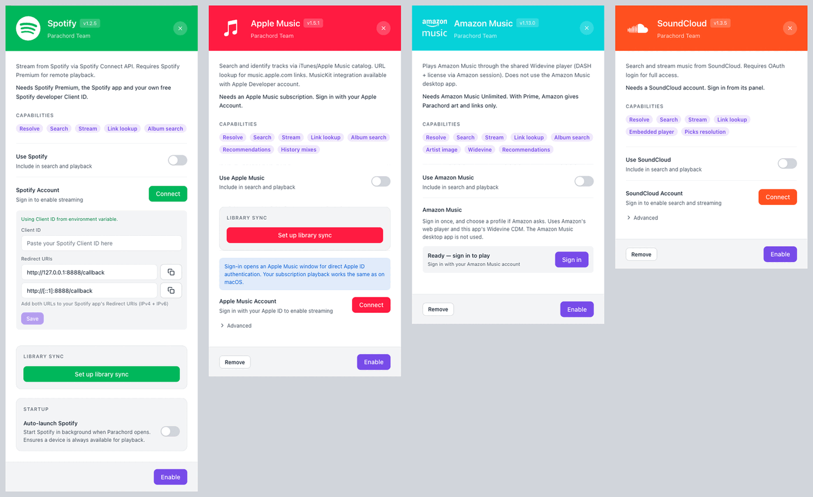
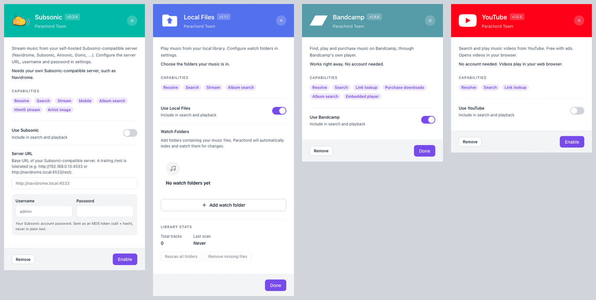
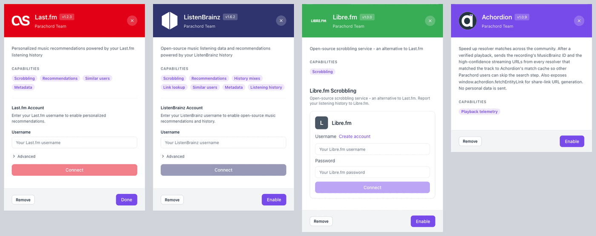
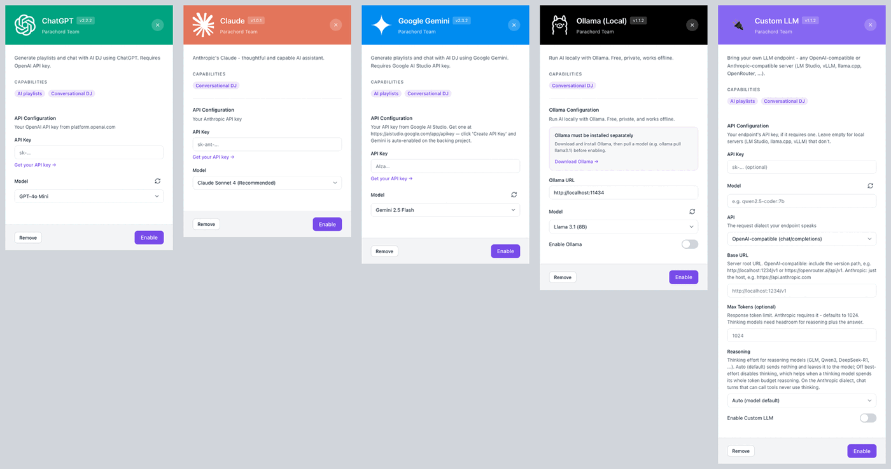
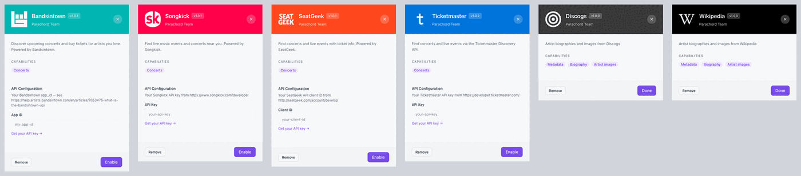

# Plug-in settings: audit and one layout for every plug-in

**Date:** 2026-11-17. **Code audited:** `main` at ca5a244a. **Component:** `src/renderer/components/plugin-settings-dialog.js` (2,367 lines; moved out of `app.js` unchanged in #1479).

**Method:** every installed plug-in's settings dialog (23), opened in the running app on a clean throwaway profile (signed out, nothing configured), light mode, captured and compared side by side; plus a read of the component, section by section. Not covered: dark mode, signed-in and enabled states (the profile had no accounts). Those belong to the build's own check (see "Done when").

Contact sheets (signed out, light mode):

| Streaming | Other sources |
|---|---|
|  |  |

| Scrobblers and Achordion | AI |
|---|---|
|  |  |

---

## 1. Why

Every plug-in's settings dialog shares a header (brand colour, logo, name, version) and a footer (Remove, then a primary button). Between them, almost nothing is shared. The same job is done a different way on nearly every plug-in, so someone setting up two services learns two interfaces. The November design audit (`2026-11-13-design-audit.md`) didn't catch this: it read code by element type (button colours, input recipes), and this dialog now passes those counts (it uses `Button`, the field set and tokens). The problems are structural: one task, several controls; one job, several layouts.

## 2. Findings

### 2.1 Turning a plug-in on has no single control

- **Two controls for one setting.** Music plug-ins (Spotify, Apple Music, Amazon Music, SoundCloud, Subsonic, YouTube) show a **"Use X"** switch near the top *and* an **Enable** button in the footer.
- **Three for some.** Ollama and Custom LLM add an "Enable Ollama" / "Enable Custom LLM" switch in the body, on top of "Use X" and the footer button.
- **The footer's primary button is "Enable" or "Done" with no visible reason.** Last.fm says **Done**, ListenBrainz says **Enable**, in the same signed-out state. Bandcamp, Local Files, Discogs and Wikipedia say Done; the AI, concert and Achordion plug-ins say Enable. (The rule in code, `showEnable` around L2304, depends on the plug-in's type, its auth requirements and whether it's active, none of which the person can see.)
- **Plug-ins without a switch** (AI, concerts, Achordion) can only be turned on by the footer button, and for keyed AI plug-ins a key is what really enables them.

### 2.2 Signing in looks different on almost every service

| Plug-in | Label | Button | Layout |
|---|---|---|---|
| Spotify | Connect | brand green | row: "Spotify Account" + button |
| Apple Music | Connect | brand red | row + a blue info banner above it |
| SoundCloud | Connect | brand orange | row + "Advanced" disclosure |
| Amazon Music | **Sign in** | **app purple** | grey inset card: "Ready — sign in to play" |
| Last.fm / ListenBrainz | Connect | full-width, brand colour; disabled is a washed-out tint, different per brand | username field above it |
| Libre.fm | Connect | full-width, **app purple** | nested card with an "L" avatar, an inline "Create account" link, username + password; a second heading repeats the description |

Service panels keep brand-coloured buttons (the maintainer's call), so Amazon Music and Libre.fm are the outliers; the label ("Connect" vs "Sign in") and the layout differ everywhere.

### 2.3 Credentials have five layouts

1. **Generic "API configuration"** (AI, concerts): a heading, a description with raw URLs pasted in (Bandsintown's is a long help-centre URL; SeatGeek's is `http://`), the field, then "Get your API key →".
2. **Spotify:** Client ID and two redirect URIs in a grey inset box, a green "Using Client ID from environment variable" note, its own Save.
3. **Subsonic:** server URL loose; username and password in a grey inset box.
4. **SoundCloud, Apple Music, Last.fm, ListenBrainz:** keys behind an "Advanced" disclosure.
5. **Ollama, Custom LLM:** their own field stacks (Custom LLM's runs to six fields with paragraph-length hints).

Field labels mix case: "API Key", "App ID", "Client ID", "Server URL", "Max Tokens (optional)" next to "Username", "Password", "Model". UI copy is sentence case.

### 2.4 Three heading styles, two section styles

- Small uppercase (CAPABILITIES, LIBRARY SYNC, STARTUP, LIBRARY STATS); bold sentence ("Spotify Account", "API Configuration", "Watch Folders"); larger bold ("Libre.fm Scrobbling").
- Some sections sit in grey inset cards (Spotify's library sync and startup, Subsonic's login, Amazon's sign-in, Ollama's install callout); the rest are flat.

### 2.5 Developer text and repeats reach the UI

- **Descriptions** (from each plug-in's `manifest.json`): Achordion's mentions `window.achordion.fetchEntityLink` and "resolver" (banned in UI copy); Amazon's "DASH + license via Amazon session" and "Widevine"; Apple Music's "MusicKit integration available with Apple Developer account"; Subsonic's "MD5 token (salt + hash)"; Gemini's "click 'Create API Key'" with a raw URL.
- **Repeats:** Ollama's "Run AI locally with Ollama. Free, private, works offline." appears twice (description and section intro); Libre.fm's description appears twice; the "requirement" line often restates the description.
- **Capability chips** with no label in `lib/capability-labels.js` fall back to their spelled-out code names: "Html5 stream", "Widevine", "Mobile", "Playback telemetry", "Artist image(s)", "Similar users", "Listening history", "History mixes", "Biography". Several aren't user-facing ideas at all (Html5 stream, Widevine, Mobile, Playback telemetry, Picks resolution).
- "Parachord Team" under every first-party plug-in's name.

### 2.6 In the code

- **Sections are keyed by service name.** Spotify, Apple Music, SoundCloud, Last.fm, ListenBrainz, Ollama, Libre.fm, Amazon Music and Local Files each have a hand-written block (`selectedResolver.id === 'spotify'`, …), against the "route by the plug-in registry, never by service name" invariant. A new plug-in gets the generic block or a new branch; nothing in between.
- **No `SettingRow`** anywhere in the dialog, though every Settings › General section uses it.
- **Seven raw `<button>`s** (L221, L636, L855, L960, L1133, L1343, L1826), mostly the "Advanced" disclosures, outside `Button`.

## 3. Goals, non-goals, anti-goals

**Goals**
- One layout every plug-in fills, so the same job looks and works the same everywhere.
- One control per job: one switch to turn a plug-in on, one button to sign in, one place for keys.
- Driven by the manifest, so a new plug-in gets a complete panel without a code change.
- Copy a listener understands, from the manifests and the capability labels.

**Non-goals**
- Changing what any plug-in can do, or how sign-in works underneath (OAuth windows, MusicKit, the Amazon web session).
- The marketplace browse view and plug-in tiles.

**Anti-goals** (would make it a failure even if it "works")
- A settings change that loses a stored key, token or watch folder.
- Service-specific needs (Spotify's redirect URIs, Local Files' folders, library sync) squeezed out or hidden so the template stays tidy.
- Brand colours replaced by the app accent on sign-in buttons.

## 4. Approaches

**A. One template, filled from the manifest; service extras as named sections (recommended).** The dialog renders a fixed sequence of parts; each part reads the manifest (`requirement`, `capabilities`, `settings.configurable`, auth type). Things only some plug-ins need (Spotify's redirect URIs and startup option, library sync, Local Files' folders and stats) become shared "extra section" components chosen by capability or manifest field, not by plug-in id. Trade-off: the biggest change, but the only one that stops a new plug-in from introducing a new layout, and it removes the service-name branches.

**B. Restyle the existing blocks to match.** Keep the per-service blocks; make them use `SettingRow`, one heading style, one sign-in row, one footer rule. Trade-off: faster and lower risk, but the branches stay and the next plug-in drifts again.

**C. Plug-ins render their own settings UI.** Each `.axe` ships its settings markup. Trade-off: maximum flexibility, and it guarantees inconsistency; also impossible to keep in step with mobile.

Recommendation: **A**, done in steps (section 7) so each step ships on its own.

## 5. The layout (approach A)

Top to bottom, for every plug-in:

1. **Header.** As now: brand colour, logo, name, version. The author line shows only for third-party plug-ins.
2. **About.** One plain-language description and, when there is one, one "needs" line ("Needs Spotify Premium"). Both from the manifest; the technical notes move out of the description (to a docs link if they matter).
3. **Capabilities.** Chips with user-facing names only. Implementation capabilities (html5Stream, widevine, mobile, playbackTelemetry, resolvePicks) are hidden; every shown one has a label in `capability-labels.js`.
4. **On/off.** One `SettingRow` with a `Switch`: "Use Spotify" / "Use ChatGPT", with a status line under it ("Signed in as …", "Needs an API key", "Not signed in"). This is the **only** on/off control: the footer button and the body switches go. Plug-ins that can't run without setup show the switch disabled with the reason ("Add an API key first").
5. **Account** (plug-ins that sign in). One shared row: the account name and status, and one button labelled **Sign in** / **Sign out** in the service's brand colour. Credentials a person might bring themselves (Spotify Client ID, SoundCloud and Last.fm keys, MusicKit token) sit under one shared **Advanced** disclosure, built on `Button`.
6. **Settings.** `SettingRow`s generated from `settings.configurable`: API key (`SecretField`), model (`Select` with its refresh action), URL, username and password, extra fields. Sentence-case labels; the "Get a key" link is the row's hint, not a separate line; long help text is one sentence plus a link.
7. **Extras** (named shared sections, chosen by capability or manifest field, never by id): library sync (`capabilities.librarySync` or the provider's sync support), startup (Spotify's "open in the background"), watch folders and library stats (Local Files), scrobbling (`ScrobblerSettingsCard` for plug-ins with `scrobbling`), install callout (Ollama's "must be installed separately", from the manifest).
8. **Footer.** **Remove** on the left (when removable), **Done** on the right, always. Done closes the dialog; it never enables anything.

Headings: the small uppercase section label (`SettingsSection`'s style) for every section. Inset grey cards only for the extras that are visually a group (library sync, watch folders); everything else flat.

## 6. Constraints

- Shared components only (CLAUDE.md "Use what exists before writing something new"): `Modal`, `Button`, `SettingRow`, `Switch`, `TextField`, `SecretField`, `Select`, `SettingsSection`, `ScrobblerSettingsCard`, `Badge`, `EmptyState`. A shared "Advanced" disclosure and a shared account row are new and go in `src/renderer/components/` with "comes from" lines.
- Route by the registry: no `selectedResolver.id === '…'` in the dialog.
- Playback limits: the status line reads `lib/playback-limits.js` (Amazon Prime, a signed-out Apple Music) and the plug-in's own refusal reasons.
- Manifest copy changes are plug-in changes: edit `plugins-src/<id>/manifest.json`, bump `manifest.version`, commit `marketplace-manifest.json` (CLAUDE.md "plugins-src is the plugin source of truth").
- Both themes, 1000px, keyboard, the loading skeleton; design-drift counts stay at 0.
- Mobile: the Android app has its own plug-in screens; the manifest copy fixes reach it through the marketplace, the layout is desktop-only.

## 7. Order of work (each step ships alone)

1. **Copy:** rewrite the descriptions and requirement lines in `plugins-src/*/manifest.json`; label or hide every capability in `capability-labels.js`. (No code structure change.)
2. **On/off:** the one switch with its status line; footer becomes Remove + Done; the body "Enable X" switches go.
3. **Account row and Advanced disclosure** as shared components; every signing-in plug-in moves onto them (Spotify, Apple Music, Amazon Music, SoundCloud, Last.fm, ListenBrainz, Libre.fm).
4. **Settings from `configurable`** on `SettingRow`s; the API-key, Subsonic and Ollama/Custom LLM blocks fold into it.
5. **Extras by capability** (library sync, startup, watch folders, scrobbling, install callout); delete the last service-name branches.

## 8. Keeping it from drifting again

- **Contact sheets for data-driven surfaces.** Commit the capture script used for this audit as a dev tool (`scripts/ui-contact-sheet.js`): it opens every variant of a surface on a throwaway profile and builds contact sheets. Any audit or UI PR on a surface with per-item variants (plug-in dialogs, playlist types, Home's states) attaches one, light and dark.
- **Audit by task, not only by element.** For each common job (turn on, sign in, enter a key, save, remove), list how every instance does it; one job, one control. Added to CLAUDE.md's "Look before calling a UI change done" and to `DESIGN_SYSTEM.md`.
- **Tests:** `design-drift` counts service-name branches in `src/renderer/components/` (`.id === '<literal>'`); a test over `plugins-src/*/manifest.json` fails on developer text in user-facing strings ("resolver", `window.`, code identifiers, raw URLs in descriptions) and on capabilities with no label.
- **Verbatim moves say so.** A PR that moves UI code unchanged says "moved, not reviewed", and anything visibly wrong is filed rather than carried silently. (#1479 moved this dialog that way without saying it hadn't been reviewed.)

## 9. Open questions

- **Disabled switch or hidden switch** for a plug-in that can't run until it's set up (AI with no key): a disabled switch with the reason (proposed) or no switch until setup is done.
- **Where technical notes go** once they leave the descriptions (a "Learn more" link to docs, or nowhere).
- **Third-party author line:** show it for every plug-in, or only when it isn't Parachord's own (proposed).

## Done when

- Every plug-in's dialog follows section 5; the same job looks and works the same across all 23.
- No `selectedResolver.id === '…'` branches in the dialog; a new plug-in with a manifest gets a complete panel.
- One on/off control per plug-in; the footer is Remove + Done everywhere.
- Manifest copy and capability labels contain no developer text; the manifest test passes.
- Checked with contact sheets in light and dark, signed out and signed in, at 1000px; skeleton and docs (`DESIGN_SYSTEM.md`, `renderer-patterns.md`) updated for the new shared components.
